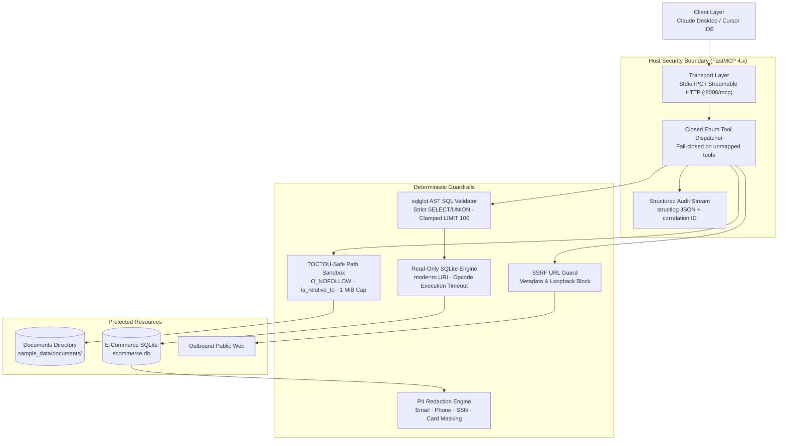

# 🛡️ MCP Secure Gateway
### Zero-Trust Tool Server for AI Agents & LLM Clients (File · Database · Web)

[](https://github.com/pine-tree111/mcp-secure-gateway/actions)
[](https://www.python.org/downloads/)
[]()
[](https://opensource.org/licenses/MIT)
[](https://github.com/astral-sh/ruff)
[](https://mypy.readthedocs.io/)

Connecting AI agents (Claude Desktop, Cursor IDE) to internal business data carries severe risks: accidental database mutation, credential exposure, PII leaks into LLM prompts, and unbounded resource consumption.

**MCP Secure Gateway** is an enterprise-grade Model Context Protocol (MCP) tool server implementing the **July 2026 Stateless Streamable HTTP specification** alongside local Stdio IPC. It enforces host-level, deterministic zero-trust guardrails across filesystem, database, and outbound web boundaries.

---

## Architecture & Zero-Trust Defense Boundaries



---

## Host-Enforced Security Invariants

| Security Invariant | Defensive Implementation | OWASP LLM Mapping |
|:---|:---|:---|
| **Zero Database Mutation** | `sqlglot` AST validation (rejects DDL/DML, multi-statements, extensions) + SQLite driver-level `mode=ro` URI | **LLM01 / LLM02** |
| **Path Sandboxing** | Canonical resolution, `is_relative_to()` boundary check, POSIX `O_NOFOLLOW` descriptor access | **LLM10** |
| **Sensitive File Immunity** | Blacklist denying `.env*`, `*.pem`, `*.key`, `.git/*`, `id_rsa*`, and credentials | **LLM06 / LLM10** |
| **Autonomous PII Masking** | Heuristic column scanner + regex scrubbing for emails, phone numbers, and SSNs | **LLM06** |
| **SSRF Prevention** | Pre-fetch URL validation blocking AWS/GCP cloud metadata (`169.254.169.254`) and loopback | **LLM10** |
| **Query DoS Mitigation** | SQLite opcode progress handler aborting queries exceeding 2.0s timeout ceiling | **LLM04** |
| **Payload Clamping** | 1 MiB max file inspection, 100-row SQL limit, 64 KB response byte ceiling | **LLM04** |
| **Fail-Closed Dispatch** | Pydantic v2 `extra="forbid"` on tool inputs; closed `ToolName` routing dictionary | **LLM07 / LLM08** |

---

## 7 Standard MCP Tools

1. `list_directory(path: str = ".")`: List sandboxed directory entries with file metadata (blacklisted files hidden).
2. `read_file(path: str)`: Read text content of sandboxed files with automated PII masking.
3. `search_files(query: str, path: str = ".")`: ReDoS-immune literal substring search across directory files.
4. `describe_schema()`: Introspect database tables and columns with automated sensitivity flags.
5. `query_database(sql: str)`: Validate, clamp, execute read-only SQL, and mask returned PII.
6. `explain_query(sql: str)`: Return query execution plan (`EXPLAIN QUERY PLAN`).
7. `fetch_url(url: str)`: Retrieve outbound web content with SSRF blocking and payload caps.

---

## 60-Second Quick Start

### 1. Clone & Install
```bash
git clone https://github.com/pine-tree111/mcp-secure-gateway.git
cd mcp-secure-gateway
uv sync --all-extras
make install-hooks       # Install pre-push Git hook
```

### 2. Seed Sample Database
```bash
make seed                # Seed sample e-commerce SQLite database
```

### 3. Quality Verification
```bash
make test                # pytest with 80%+ branch coverage
make lint                # ruff check + mypy --strict
make pre-push            # run all 11 pre-push quality gates
```

### 4. Run the Server

**Option A: Local Process (Stdio or HTTP)**
```bash
make run                 # Start local server (python -m app.server)
```

**Option B: Hardened Docker Container (Loopback 127.0.0.1:8000)**
```bash
make docker-build        # Build multi-stage hardened image
make docker-up           # Start container in background
curl -s http://127.0.0.1:8000/health
make docker-down         # Stop container
```

### 5. Connect Claude Desktop
See [SETUP.md](SETUP.md) for copy-paste client configuration (supports local Stdio and Docker HTTP modes).

---

## Developer Commands (Makefile)

| Command | Action |
|:---|:---|
| `make test` | Run pytest with 80%+ branch coverage enforcement |
| `make lint` | Run Ruff linter and Mypy strict type checking |
| `make format` | Auto-format Python source files with Ruff |
| `make audit` | Dependency CVE vulnerability scan via pip-audit |
| `make pre-push` | Run full 11-gate quality audit script |
| `make seed` | Seed local e-commerce SQLite sample database |
| `make run` | Start server locally (`python -m app.server`) |
| `make install-hooks` | Install pre-push audit script as Git hook |
| `make docker-build` | Build production multi-stage Docker container |
| `make docker-up` | Run container in background (`127.0.0.1:8000:8000`) |
| `make docker-down` | Stop and tear down Docker container |
| `make clean` | Remove pytest, mypy, and ruff cache directories |

---

## License

MIT License — Copyright (c) 2026 Shafiul Ismam. See [LICENSE](LICENSE) for details.
